# Awesome-AI-Observability-Evaluation 🔍⚡

  

  
  
  
  
  
  

---

## 🌟 Top AI Observability & Evaluation Ecosystem

> A curated list of production-ready SaaS platforms and battle-tested open-source GitHub projects for LLM tracing, automated LLM-as-a-judge scoring, prompt evaluation, RAG assessment, and real-time AI safety guardrails.

**Last updated:** October 2026 📅

This directory tracks the foremost **SaaS platforms** and **open-source tools** engineered for **AI Observability & LLM Evaluation**. Modern generative applications, multi-agent frameworks, and retrieval-augmented generation (RAG) architectures require deep visibility into every LLM invocation, vector search, tool execution, and agentic decision branch—scoring responses automatically, mitigating hallucinations, detecting prompt injections, and halting performance regressions before deployment.

---

## 📑 Table of Contents

- [📊 Sector Overview & Market Dynamics](#-sector-overview--market-dynamics)
- [☁️ SaaS & Hosted Platforms](#️-saas--hosted-platforms)
- [💻 Open-Source GitHub Projects](#-open-source-github-projects)
  - [🏆 High-Star Evaluation & Observability Frameworks](#-high-star-evaluation--observability-frameworks)
  - [🛠️ Specialized Tooling & Standard Specifications](#️-specialized-tooling--standard-specifications)
- [📈 Star History](#-star-history)
- [🤝 How to Contribute](#-how-to-contribute)
- [💖 Support & Sponsorship](#-support--sponsorship)
- [⚠️ Disclaimer](#️-disclaimer)

---

## 📊 Sector Overview & Market Dynamics

The dedicated AI & LLM Observability sector is estimated at **$1.4B to $1.8B in 2026** and is rapidly compounding toward **$5.3B–$7.1B+ by 2030** (~30%+ CAGR), propelled by ubiquitous enterprise generative AI adoption and autonomous multi-agent deployments. Structurally, the ecosystem exhibits a **bifurcated dynamic transitioning from high fragmentation to enterprise consolidation**: while the specialized developer and evaluation tier remains moderately fragmented among agile venture-backed startups and open-source standards, the broader commercial observability market is tilting toward concentration as incumbent infrastructure giants (Dynatrace acquiring Arize AI for $915M, Snowflake acquiring TruEra, ClickHouse acquiring Langfuse, Datadog, and CoreWeave) aggressively integrate specialized LLM monitoring into unified APM platforms.

---

## ☁️ SaaS & Hosted Platforms

The table below catalogs premier hosted AI evaluation and observability platforms, ranked descending by estimated company valuation / size.

| Platform | Valuation / Size | Starting Pricing | Free Tier / Trial Limits | Key Capabilities & Highlights |
| :--- | :--- | :--- | :--- | :--- |
| **[LangSmith](https://smith.langchain.com/)** | **~$1.25B** (Series B, LangChain) | **$39 / seat / mo** (Plus tier) | **Free Developer tier**: 1 seat, up to 5,000 base traces/month, prompt playground, and evaluation testing. | LangChain's native observability platform providing trace-level visibility into agent tool calling, chains, latency breakdowns, and regression CI/CD gates. |
| **[Arize AI](https://arize.com/)** | **~$915M** (Acquired by Dynatrace, $131M raised) | **$50 / mo** (AX Pro tier) | **AX Free plan**: 25,000 spans/month, 1 GB storage, 15-day data retention, 2 seats. | Enterprise-scale telemetry, 50+ research-backed evaluation metrics, embedding drift detection, and full OpenTelemetry compatibility. |
| **[Braintrust](https://www.braintrust.dev/)** | **~$800M** (Series B, $121M+ raised) | **$249 / mo** (Pro plan) | **Free Starter tier**: 10,000 eval scores/month, 1 GB log storage/month, 14-day retention, unlimited projects. | Evaluation-first observability platform featuring deterministic & LLM judge scoring, CI/CD regression gates, prompt playground, and dataset management. |
| **[Fiddler AI](https://www.fiddler.ai/)** | **~$200M+** (Series C, $62M+ raised) | **$0.002 / trace** (Developer tier pay-as-you-go) | **Free tier**: Unlimited real-time Centor guardrails (<80ms latency) for hallucination, PII, and prompt injection (tracing disabled). Also offers 30-day AWS trial. | Unified observability for predictive models and LLM agents, RAG Health Metrics (Context & Answer Relevance), explainable AI, and bias tracking. |
| **[Galileo](https://galileo.ai/)** | **Growth-Stage** ($68M raised, Series B) | **$100 / mo** (Pro tier, billed annually) | **Free Developer tier**: 5,000 traces/month, unlimited users, unlimited custom evaluations, and standard logging. | Enterprise LLM evaluation intelligence, multi-modal guardrails, Experiments API, hallucination detection indices, and automated fine-tuning insights. |
| **[Patronus AI](https://www.patronus.ai/)** | **Growth-Stage** ($70M raised, Series B) | **$25 / mo** (Base plan; usage-based API starts at $10/1k calls) | **Free Developer tier**: $10 complimentary API credits, 2 projects, 5 experiments per project, 14-day trace retention. | Automated evaluation API with specialized evaluators (*Lynx* for hallucinations, *FinanceBench*, PII detection, adversarial prompt injection defense). |
| **[Arthur AI](https://www.arthur.ai/)** | **~$45M** ($65M+ raised) | **$60 / mo** (Premium tier) | **Free tier**: Up to 4 active model use cases, 7-day data retention, standard drift & accuracy tracking, unlimited user seats. | Enterprise AI governance platform featuring *Arthur Shield* for real-time inference guardrails and *Arthur Bench* for comparative model evaluation. |
| **[TruEra](https://truera.com/)** | **Acquired** ($43M raised prior to Snowflake acquisition) | **Enterprise custom / Snowflake native** | **Open-source TruLens engine**: 100% free with no synthetic usage caps; enterprise trial through Snowflake Partner Network (30-day trial). | Enterprise AI quality management, RAG triad evaluation, model explainability, and governance (now being embedded into Snowflake Cortex). |
| **[WhyLabs](https://whylabs.ai/)** | **Acquired** ($14M raised prior to Apple acquisition) | **$125 / mo** (Expert tier via AWS Marketplace) | **Free Starter tier**: 1 model resource monitored, up to 10M predictions/month, 14-day data retention, open-source `whylogs` profiling. | Privacy-preserving AI observability powered by statistical data profiles, anomaly detection, output distribution drift, and compliance telemetry. |
| **[Humanloop](https://humanloop.com/)** | **Acqui-hired** (Anthropic, $8M raised) | **$0 (Historical free tier)** / Sunset standalone | **Free tier (legacy)**: 2 team members, 50 evaluation runs, 10,000 logs/month (acqui-hired by Anthropic in Aug 2025). | Collaborative prompt engineering studio, human-in-the-loop feedback workflows, and production trace scoring (team joined Anthropic). |

---

## 💻 Open-Source GitHub Projects

The open-source ecosystem provides transparent, vendor-neutral, and self-hosted AI observability. The list is sorted descending by GitHub Stars_Count.

### 🏆 High-Star Evaluation & Observability Frameworks

| Project | GitHub_Stars | License | Description & Architectural Highlights |
| :--- | :--- | :--- | :--- |
| **[Langfuse](https://github.com/langfuse/langfuse)** |  | MIT Core / FSL | **Complete Open-Source LLM Engineering & Tracing Platform**. Provides detailed span execution trees, automated eval judges, prompt versioning, playground, and cost tracking. Self-hostable via Docker/Kubernetes with ClickHouse backend. |
| **[Promptfoo](https://github.com/promptfoo/promptfoo)** |  | MIT | **Lightweight Test & Red-Teaming CLI Framework**. Specialized in CI/CD automated grading, prompt injection defense testing, output quality regression assertions, and multi-model benchmarking. Fast, deterministic, and offline-capable. |
| **[Opik (Comet)](https://github.com/comet-ml/opik)** |  | Apache-2.0 | **Full-Stack Agent & LLM Observability Platform**. 100% permissively licensed alternative with production tracing, real-time guardrails, dataset curation, prompt management, and native Python/TypeScript SDKs. |
| **[DeepEval](https://github.com/confident-ai/deepeval)** |  | Apache-2.0 | **The Pytest of LLM Unit Testing & Synthetic Benchmarking**. Features 20+ built-in metrics (G-Eval, Answer Relevance, Hallucination, Faithfulness), red-teaming vulnerability scans, and effortless GitHub Actions CI integration. |
| **[Ragas](https://github.com/vibrantlabsai/ragas)** |  | Apache-2.0 | **The Benchmark Framework for Retrieval-Augmented Generation (RAG)**. Evaluates pipeline performance across Faithfulness, Answer Relevance, Context Precision, and Context Recall using reference-free scoring pipelines. |
| **[Arize Phoenix](https://github.com/Arize-ai/phoenix)** |  | Elastic License 2.0 | **OpenTelemetry-Native AI Observability for LLM Applications**. Offers trace visualization, embedding drift analysis, automated benchmark evals, and seamless connectors for LangChain, LlamaIndex, DSPy, and smolagents. |
| **[Cleanlab](https://github.com/cleanlab/cleanlab)** |  | AGPL-3.0 | **Data-Centric AI & Automated Label Quality Inspection**. Diagnoses label noise, hallucinations, dataset anomalies, and untrustworthy outputs across tabular, NLP, and LLM training/eval datasets. |
| **[Evidently](https://github.com/evidentlyai/evidently)** |  | Apache-2.0 | **Production ML & LLM Monitoring Dashboard Engine**. Generates interactive visual reports and automated telemetry checks for statistical data drift, semantic drift, prompt leaks, and classification performance. |
| **[OpenCompass](https://github.com/open-compass/opencompass)** |  | Apache-2.0 | **Comprehensive Foundation Model & Agent Evaluation Platform**. Supports 100+ public benchmarks (MMLU, GSM8K, HumanEval, AGIEval), multi-modal capabilities, distributed test execution, and leaderboards. |
| **[OpenLLMetry (Traceloop)](https://github.com/traceloop/openllmetry)** |  | Apache-2.0 | **Zero-Code Instrumentation via OpenTelemetry Standards**. Standardizes spans for OpenAI, Anthropic, Bedrock, LangChain, LlamaIndex, Chroma, and Pinecone directly into Datadog, Dynatrace, Honeycomb, or Phoenix. |
| **[Helicone](https://github.com/Helicone/helicone)** |  | Apache-2.0 | **Lightweight LLM Proxy, Observability & Rate Limiting Gateway**. Intercepts API requests with a single URL change to provide real-time token cost tracking, prompt caching, threat detection, and usage analytics. |
| **[Agenta](https://github.com/agenta-ai/agenta)** |  | Apache-2.0 | **Developer-First LLMOps Platform for Rapid Prompt Evaluation**. Enables side-by-side prompt experimentation, automated test dataset execution, and deployment of fine-tuned prompts directly via REST APIs. |
| **[TruLens](https://github.com/truera/trulens)** |  | Apache-2.0 | **Enterprise-Grade Evaluation & Tracking for Agents and RAG Pipelines**. Features OpenTelemetry instrumentation, RAG Triad scoring, and Agent GPA validation benchmarked directly against human ground truth. |
| **[Inspect AI](https://github.com/UKGovernmentBEIS/inspect_ai)** |  | MIT | **Official AI Safety & Capability Evaluation Framework by the UK AISI**. Designed for large-scale safety benchmarks, cybersecurity assessments, autonomous agent evals, and multi-step reasoning validation. |
| **[WhyLogs](https://github.com/whylabs/whylogs)** |  | Apache-2.0 | **Deterministic, Privacy-Preserving Statistical Data Logging**. Generates lightweight mathematical sketches of tabular and text data streams to detect distribution shifts without transmitting raw sensitive inputs. |
| **[NannyML](https://github.com/NannyML/nannyml)** |  | Apache-2.0 | **Post-Deployment Model Monitoring Without Ground Truth**. Estimates real-time production performance degradation and detects multivariate data drift using algorithm-based confidence bounds. |
| **[OTel GenAI Semantic Conventions](https://github.com/open-telemetry/semantic-conventions-genai)** |  | Apache-2.0 | **Official Industry Standard for LLM Telemetry**. Formalizes attribute specifications (`gen_ai.system`, `gen_ai.usage.tokens`, `gen_ai.request.model`) across language models, agents, and vector databases. |
| **[AgentCompass](https://github.com/open-compass/AgentCompass)** |  | Apache-2.0 | **Multi-Agent Evaluation Infrastructure**. Features 30+ public benchmarks, 10+ agent harnesses, trajectory playback, tool invocation audit trails, and multi-turn execution step diagnosis. |

---

### 🛠️ Specialized Tooling & Standard Specifications

- **[OpenTelemetry GenAI Semantic Conventions](https://github.com/open-telemetry/semantic-conventions-genai)** — Vendor-neutral standard attribute names for model calls, agents, and tool use.
- **[WhyLogs](https://github.com/whylabs/whylogs)** — Statistical profiling and drift detection engine for streaming pipelines.
- **[OpenLLMetry](https://github.com/traceloop/openllmetry)** — Portable, vendor-agnostic OTel tracing spans.
- **[n8n AI Observability Templates](https://n8n.io)** — Automated workflow orchestration for production quality anomaly alerts and Slack notifications.

---

## 📈 Star History

---

## 🤝 How to Contribute

Contributions are warmly welcomed! Help make this the most accurate and up-to-date AI observability resource on GitHub:

1. 🍴 Fork the repository.
2. 🌿 Create a feature branch: `git checkout -b feature/add-new-tool`.
3. 📝 Add your entry with link, factual pricing/limits or license details, and stars.
4. 🚀 Open a Pull Request with a clear description of the project.

---

## 💖 Support & Sponsorship

If you find this curated ecosystem directory valuable for your research, team, or production stack:
- ⭐ **Star this repository** to support our work and help other engineers discover it.
- 🍴 **Fork the repo** to keep a copy handy or contribute your findings.
- 📢 **Share with your colleagues** in AI engineering and MLOps communities.
- ☕ **Sponsor the Maintainer**: Support ongoing curation, research, and maintenance via the [GitHub Sponsors Dashboard](https://github.com/sponsors/ishandutta2007).

---

## ⚠️ Disclaimer

- This is an independent **community-curated directory**; listings do not represent commercial endorsement.
- Tracing data frequently captures customer prompts and enterprise contexts; verify GDPR, HIPAA, and SOC-2 compliance before streaming production traces to hosted vendors.
- When selecting tools for privacy-critical environments, prioritize permissively licensed open-source frameworks (Apache-2.0 / MIT) that support 100% air-gapped self-hosting.
- LLM-as-a-judge evaluators produce probabilistic metrics—always calibrate automated scoring pipelines with human-in-the-loop validation for mission-critical production decisions.

---

  <b>Built with ❤️ for ML engineers, LLM researchers, and AI platform teams worldwide.</b>

